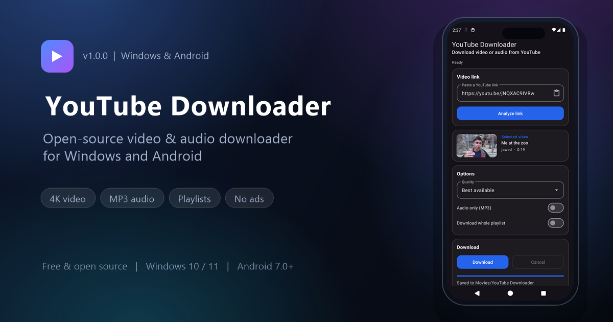

# YouTube Downloader



A free video and audio downloader for **Windows 10/11** and **Android 7.0+**.
Paste a link, choose a quality, and download a single video, a full playlist, or
hand-picked playlist entries — including MP3 audio.

**[Windows installer](https://github.com/amuejunankar/Youtube-Downloader/releases/latest/download/YouTubeDownloader-Installer.exe)** ·
**[Portable .exe](https://github.com/amuejunankar/Youtube-Downloader/releases/latest/download/YouTubeDownloader_Portable.exe)** ·
**[Android APK](https://github.com/amuejunankar/Youtube-Downloader/releases/latest/download/YouTubeDownloader-Android.apk)** ·
**[Website](https://amuejunankar.github.io/Youtube-Downloader/)**

> Download only content you own or are authorised to download. This app does not
> bypass DRM, paywalls, or authentication.

## Features

- Single video, entire playlist, or selected playlist entries.
- Quality list built from the formats the video actually provides, up to 8K.
- MP3 extraction and merged high-resolution video/audio.
- Honest fallback reporting when the requested resolution is unavailable.
- Skip existing files, resume partial downloads, and automatic retries.
- Background downloads with per-item status and safe cancellation.
- Windows: bundled FFmpeg, no Python required.
- Android: saves through MediaStore and accepts shared YouTube links.
- Ships its own JavaScript runtime (QuickJS-NG) and yt-dlp challenge solver,
  so downloads work without installing Deno, Node or anything else.
- Desktop: checks PyPI for a newer yt-dlp at launch and installs it into a
  per-user folder only after a health check. The bundled copy stays as the
  offline fallback, and **Help ▸ Roll back yt-dlp update** undoes an update.
- No ads, no tracking, and no cookies or tokens written to logs.

## Install

### Windows

Download the **installer** (recommended) or the **portable .exe**. Both are
self-contained, include FFmpeg, and need no administrator rights. The portable
build runs from a single file; the installer adds Start-menu shortcuts and an
uninstaller.

### Android

Download the **APK** and open it, allowing installs from unknown sources when
prompted. The app requires Android 7.0+ and is built for `arm64-v8a` phones
(plus `x86_64` emulators). Videos are saved to `Movies/YouTube Downloader` and
audio to `Music/YouTube Downloader`.

## Code signing

The Windows builds are Authenticode-signed by CI when signing credentials are
present in the repository, so the installer and the portable `.exe` show a
publisher name instead of an unknown one. Signing uses
[Azure Artifact Signing](https://learn.microsoft.com/azure/artifact-signing/)
(formerly Trusted Signing) — about $10/month, no USB token, and it works from a
Windows GitHub runner. Public Trust certificates are issued to organizations in
the USA, Canada, the EU, the UK, Australia, New Zealand, Japan, South Korea,
Singapore, Switzerland, Norway and Israel, and to individuals in the USA and
Canada; outside those places a certificate from a CA such as SSL.com or Sectigo
is the alternative.

To turn it on, create the Artifact Signing account, an identity validation and a
certificate profile, then register an app in Microsoft Entra ID with a
federated credential for this repository and add these repository secrets:

| Secret | Value |
| --- | --- |
| `AZURE_SIGNING_CLIENT_ID` | Application (client) ID of the app registration |
| `AZURE_SIGNING_TENANT_ID` | Directory (tenant) ID |
| `AZURE_SIGNING_SUBSCRIPTION_ID` | Subscription that holds the signing account |
| `AZURE_SIGNING_ENDPOINT` | Account endpoint, e.g. `https://eus.codesigning.azure.net/` |
| `AZURE_SIGNING_ACCOUNT` | Artifact Signing account name |
| `AZURE_SIGNING_CERTIFICATE_PROFILE` | Certificate profile name |

The next build signs both `.exe` files, verifies each signature with
`Get-AuthenticodeSignature` and fails if any comes back invalid. With the secrets
missing the build still publishes, and the log carries a warning.

Signing removes the unknown-publisher warning and gives each release a stable
identity, but Windows SmartScreen still treats a new app cautiously: reputation
builds from the publisher certificate over successive signed releases, so the
first signed downloads can still show a prompt. Signed or not, every release now
ships `SHA256SUMS.txt` so a download can be checked with
`certutil -hashfile <file> SHA256` on Windows, or `sha256sum -c SHA256SUMS.txt`
next to the downloaded files on macOS and Linux.

## Run from source

Requires Python 3.11–3.13 on Windows.

```bat
scripts\install.bat
winget install Gyan.FFmpeg
scripts\run.bat
```

If some formats are missing, install a JavaScript runtime:
`winget install DenoLand.Deno`. If FFmpeg lives outside `PATH`, set it via
**File ▸ Set FFmpeg location…**.

## Tests

```bat
scripts\run_tests.bat
```

Network tests are opt-in:

```bat
.venv\Scripts\activate.bat
set RUN_INTEGRATION=1
pytest tests/test_integration.py -v
```

## Build

- **Windows, installer:** `installer\build_installer.bat` (add `portable` to
  also build the one-file .exe). It builds the folder bundle with FFmpeg when
  it is missing, reads the version from `app\__init__.py`, and writes
  `dist\YouTubeDownloader-Setup-<version>.exe`. Needs Inno Setup 6
  (`winget install JRSoftware.InnoSetup`).
- **Windows, app only:** `scripts\build_exe.bat` produces
  `dist\YouTubeDownloader.exe` (or `dist\YouTubeDownloader\` with the `folder`
  argument).
- **Both apps, without the build machines:** push to `main` (or a `v*` tag, or
  run the "Build and release Windows and Android" workflow by hand). GitHub
  Actions builds the Windows bundle, the portable .exe, the installer and the
  signed Android APK, then publishes all of them to the release tagged
  `v<version>` as `YouTubeDownloader-Installer.exe`,
  `YouTubeDownloader_Portable.exe` and `YouTubeDownloader-Android.apk`, which
  is what `releases/latest/download/` serves.
- **Android:** with JDK 17 and Android SDK 36 installed, run
  `.\gradlew assembleRelease` in `android\`. Signing reads
  `android\keystore.properties`.

## Troubleshooting

- **Extraction errors after a YouTube change:** restart the app; it checks
  PyPI for a newer yt-dlp on launch. **Help ▸ Check for yt-dlp update…** does
  the same on demand, and **Help ▸ Roll back yt-dlp update** returns to the
  previous or bundled copy. `pip install -U yt-dlp` is only needed when running
  from source.
- **High resolutions unavailable, or "FFmpeg could not finish the download":**
  the app merges video with audio through FFmpeg and falls back to
  single-file formats (no merging, no MP3) when FFmpeg is missing or cannot
  run. Point **File ▸ Set FFmpeg location…** at a working folder. Builds ship
  their own copy from `scripts/fetch_ffmpeg.py`, never a package-manager shim.
- **Formats missing entirely:** install Deno or Node; the app also bundles
  QuickJS for this.
- **Antivirus flags a fresh Windows build:** common for PyInstaller one-file
  executables; add an exclusion or use the folder build.
- **Private/age-restricted videos:** require authentication and are not
  bypassed by design.

## Project layout

```text
app/        PySide6 desktop app and yt-dlp engine
android/    Kotlin app (Material 3, youtubedl-android, MediaStore)
docs/       GitHub Pages site
tests/      pytest suite, including a headless GUI smoke test
scripts/    setup, run, test, and build helpers
installer/  Inno Setup definition
```

## Links

- Website: <https://amuejunankar.github.io/Youtube-Downloader/>
- Releases: <https://github.com/amuejunankar/Youtube-Downloader/releases>
- Issues: <https://github.com/amuejunankar/Youtube-Downloader/issues>
