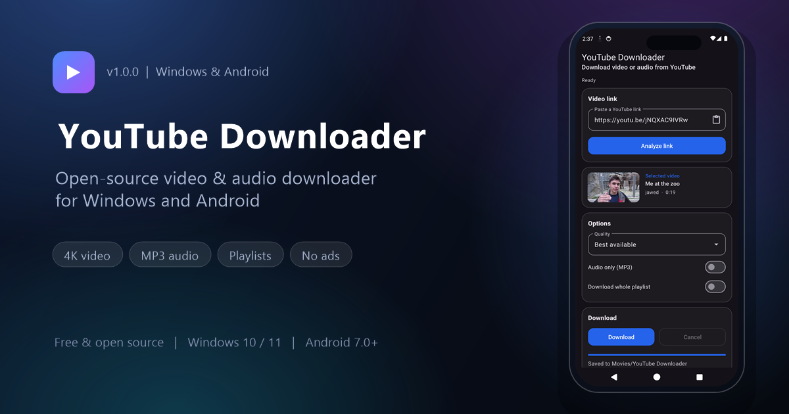

# YouTube Downloader



A free video and audio downloader for **Windows 10/11** and **Android 7.0+**.
Paste a link, choose a quality, and download a single video, a full playlist, or
hand-picked playlist entries — including MP3 audio.

**[Windows installer](https://github.com/amuejunankar/Youtube-Downloader/releases/download/1.0.0/YouTubeDownloader-Installer.exe)** ·
**[Portable .exe](https://github.com/amuejunankar/Youtube-Downloader/releases/download/1.0.0/YouTubeDownloader_Portable.exe)** ·
**[Android APK](https://github.com/amuejunankar/Youtube-Downloader/releases/download/1.0.0/YouTubeDownloader-Android-1.0.0.apk)** ·
**[Website](https://amuejunankar.github.io/Youtube-Downloader/)**

> Download only content you own or are authorised to download. This app does not
> bypass DRM, paywalls, or authentication.

## Features

- Single video, entire playlist, or selected playlist entries.
- Quality list built from the formats the video actually provides, up to 8K.
- MP3 extraction and merged high-resolution video/audio.
- Honest fallback reporting when the requested resolution is unavailable.
- Skip existing files, resume partial downloads, and automatic retries.
- Background downloads with per-item status and safe cancellation.
- Windows: bundled FFmpeg, no Python required.
- Android: saves through MediaStore and accepts shared YouTube links.
- No ads, no tracking, and no cookies or tokens written to logs.

## Install

### Windows

Download the **installer** (recommended) or the **portable .exe**. Both are
self-contained, include FFmpeg, and need no administrator rights. The portable
build runs from a single file; the installer adds Start-menu shortcuts and an
uninstaller.

### Android

Download the **APK** and open it, allowing installs from unknown sources when
prompted. The app requires Android 7.0+ and is built for `arm64-v8a` phones
(plus `x86_64` emulators). Videos are saved to `Movies/YouTube Downloader` and
audio to `Music/YouTube Downloader`.

## Run from source

Requires Python 3.11–3.13 on Windows.

```bat
scripts\install.bat
winget install Gyan.FFmpeg
scripts\run.bat
```

If some formats are missing, install a JavaScript runtime:
`winget install DenoLand.Deno`. If FFmpeg lives outside `PATH`, set it via
**File ▸ Set FFmpeg location…**.

## Tests

```bat
scripts\run_tests.bat
```

Network tests are opt-in:

```bat
.venv\Scripts\activate.bat
set RUN_INTEGRATION=1
pytest tests/test_integration.py -v
```

## Build

- **Windows:** `scripts\build_exe.bat` produces `dist\YouTubeDownloader.exe`.
  For the installer, build the folder variant with FFmpeg bundled and run
  `installer\build_installer.bat` (needs Inno Setup 6).
- **Android:** with JDK 17 and Android SDK 36 installed, run
  `.\gradlew assembleRelease` in `android\`. Signing reads
  `android\keystore.properties` (not committed).

## Troubleshooting

- **Extraction errors after a YouTube change:** `pip install -U yt-dlp`.
- **High resolutions unavailable:** install FFmpeg; install Deno if formats are
  still missing.
- **Antivirus flags a fresh Windows build:** common for PyInstaller one-file
  executables; add an exclusion or use the folder build.
- **Private/age-restricted videos:** require authentication and are not
  bypassed by design.

## Project layout

```text
app/        PySide6 desktop app and yt-dlp engine
android/    Kotlin app (Material 3, youtubedl-android, MediaStore)
docs/       GitHub Pages site
tests/      pytest suite, including a headless GUI smoke test
scripts/    setup, run, test, and build helpers
installer/  Inno Setup definition
```

## Links

- Website: <https://amuejunankar.github.io/Youtube-Downloader/>
- Releases: <https://github.com/amuejunankar/Youtube-Downloader/releases>
- Issues: <https://github.com/amuejunankar/Youtube-Downloader/issues>
